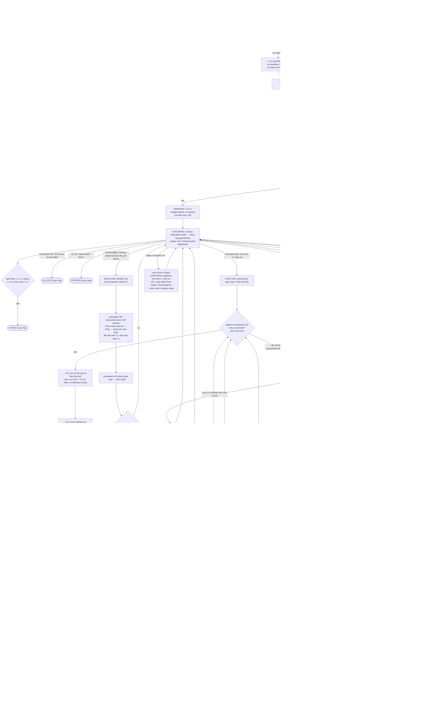

# maze_nav behaviour

Flow of `ros2 launch maze_nav maze_nav.launch.py` with default arguments. It is the current
code in `src/maze_nav` (`explorer.py`, `cmd_vel_bridge.py`, `stair_detector.py`,
`curtain_detector.py`, `scene_trigger.py`) **plus the design decisions of 2026-11-21** (D1–D11
below). States in `CAPS` are the values on `/maze/status`.

Legend: ✅ = decided 2026-11-21 and implemented 2026-11-22 (unit tests + simulator; not yet
run on the robot). Unmarked = was already in the code.

Also active while `EXPLORING`, not drawn as branches:

- **TURNING**: before a goal whose turn on the spot would hit a mapped wall, the explorer turns the long way itself (blocked both ways: left to Nav2).
- **FACING_QR**: a QR code located but not read → turn to face it and hold while `qr_scanner` decodes (perception on).
- ~~LOOKING~~: removed (D11).
- **Nav2 recovery** (`config/maze_bt.xml`): replan 1 Hz → follow path; recoveries clear costmaps, spin 90°, wait 3 s (no BackUp; the bridge never reverses).
- **curtain_yolo** (off: `curtain_yolo:=false`, no trained model yet): YOLO curtain boxes in junction / dead-end looks and CURTAIN only, never while EXPLORING; meant to replace the lie-down verification once trained (to_do.md ## curtains).
- **cmd_vel_bridge watchdog**: clamps 0.25 m/s / 0.5 rad/s, never backwards; stops on stale lidar/odom or an odom jump.

## Decisions (2026-11-21) and the code changes made for them

| # | Decision | Code before | Change made | Where |
|---|---|---|---|---|
| D1 | Not standing at launch → error message, wait until standing, then carry on with startup | `auto_stand:=true` sends stand once (a stand/sit toggle) when the lidar shows the robot lying, waits ≤ 15 s; posture unknown → nothing sent, startup goes on. `wall_scan` retries the floor 20 times, then guesses | No stand command; log an ERROR and loop on the posture check; hold gait, floor measurement and `PAUSED` until standing | `cmd_vel_bridge.py` (`auto_stand`, `stand_timeout`), `wall_scan.py` floor retry, `maze_nav.launch.py:450` |
| D2 | At a junction, for each adjacent unexplored cell: turn to face it, move sideways to the centre of the junction cell, then scan | Turns to face each way (0.5 s hold), no centring. **No sideways motion is possible today**: the bridge forwards only `linear.x` and `angular.z` (`cmd_vel_bridge.py:1032`), Nav2 `max_velocity` y = 0 | Forward a clamped `linear.y` in the bridge (watchdog + wall check too); explorer step "strafe to cell centre line" checked against walls on `/map`; confirm the Lite3 follows `linear.y` in auto mode | `cmd_vel_bridge.py:1003-1033`, `explorer.py` junction look, `config/nav2_params.yaml:256` |
| D3 | Candidates noted during the junction scan are verified right after it (all adjacent cells scanned), nearest first | A curtain candidate is inspected right after the look; a stairs candidate waits until the junction's other ways are explored (`curtain_branch.Deferral`). Dead-end candidates are handled after that stop | Detectors report candidates instead of handing over; the explorer keeps the junction's candidate list and releases them nearest first once the scan is done. A rejected candidate goes back to the list; when none are left, D6 | `explorer.py`, `stair_detector.py` 2b, `curtain_detector.py` 2b, `curtain_branch.py` |
| D4 | Stairs confirmed → pause navigation → line up and square → AI mode → walk 1.3 m → carry on by itself | Same up to the walk, but walks 1.2 m and then holds `AT_STAIRS` until the operator's `/maze/start` (which leaves AI mode) and `lite3_auto` | `ai_walk_distance` 1.2 → 1.3; after the walk the bridge leaves AI mode itself (AI exit → manual → Move → gait → **auto mode**, which the code has never sent unprompted) and the explorer resumes `EXPLORING` without `/maze/start` | `cmd_vel_bridge.py:44-62, 202`, `explorer.py` AT_STAIRS hold, `stair_detector.py` 4 |
| D5 | Don't leave the junction cell until every adjacent unexplored cell has been scanned | After the look it drives to the cell before each dead-end way (`junction_follow`), so it leaves mid-scan | Drop the dead-end visits from the junction follow-up; all scanning happens from the junction cell | `explorer.py:2426` onwards |
| D6 | Then leave by the nearest unexplored cell | Drives one cell into the rightmost way that isn't a dead end | Replace "rightmost" with the nearest unexplored adjacent cell (by path length) | `explorer.py:2426-2503` |
| D7 | A room cell with an object seen during the junction scan is marked explored once scene understanding has been triggered | Object cells are blocked (keepout) and later get a room look-in from a neighbouring cell | After its `/scene/capture` in the junction scan, mark the cell explored (no frontier goal, no later room look-in) | `explorer.py` `room_looks`, `block_objects` |
| D8 | Gait RUG General gear (changed 2026-11-22: H-Step for now); poster detection off | `gait:=rug`, launch starts only `qr_scanner` | Default gait `hstep` in the launch and cmd_vel_bridge (`gait:=rug` for RUG General gear); LOOKING and the poster wording removed | `maze_nav.launch.py`, `cmd_vel_bridge.py` |

| D9 | No start scan | Launch passes `start_scan:=false`, but the explorer's own default is `True` | Set the explorer default to `False` so a run without the launch file doesn't scan | `explorer.py:357` |
| D10 | Dead ends outside a junction scan keep the current look (0.5 s hold, Pose-mode left + right wall, QR on); candidates seen there are queued, not verified on the spot | Candidates seen during a dead-end stop are inspected / checked once the explorer is back in `EXPLORING` | Add them to the explorer's candidate queue (D3). The queue is worked nearest first after the next junction scan, or when no frontiers are left, before ending `NO_EXIT` | `explorer.py`, `stair_detector.py` 2b, `curtain_detector.py` 2b |
| D11 | Remove LOOKING (look-around in a QR room until a survivor poster is confirmed): poster detection is off | `look_topic` from poster_detector; `LOOKING` state in the explorer and in the detectors' `trigger_states` | Remove the LOOKING state, `look_topic` subscription and its parameters; drop `LOOKING` from `stair_detector` / `curtain_detector` `trigger_states` and from `at_dead_end` | `explorer.py` (`look_*`, ~1767-1800), `stair_detector.py`, `curtain_detector.py` |

No open questions left.
